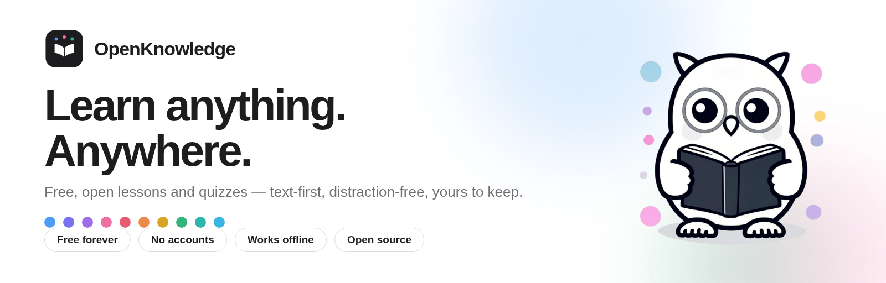
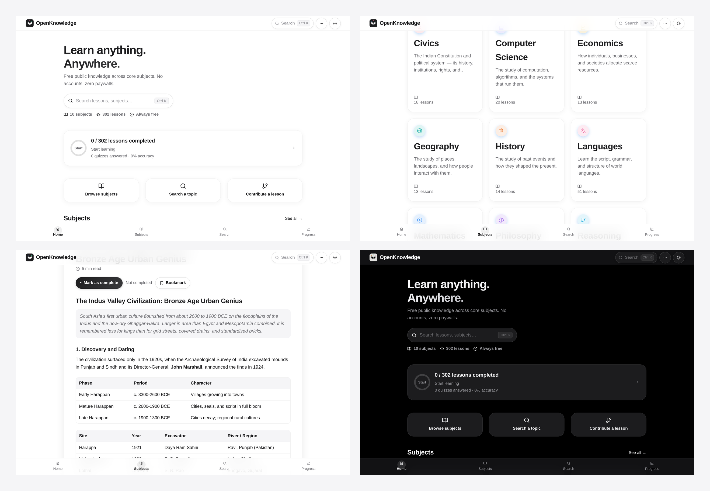
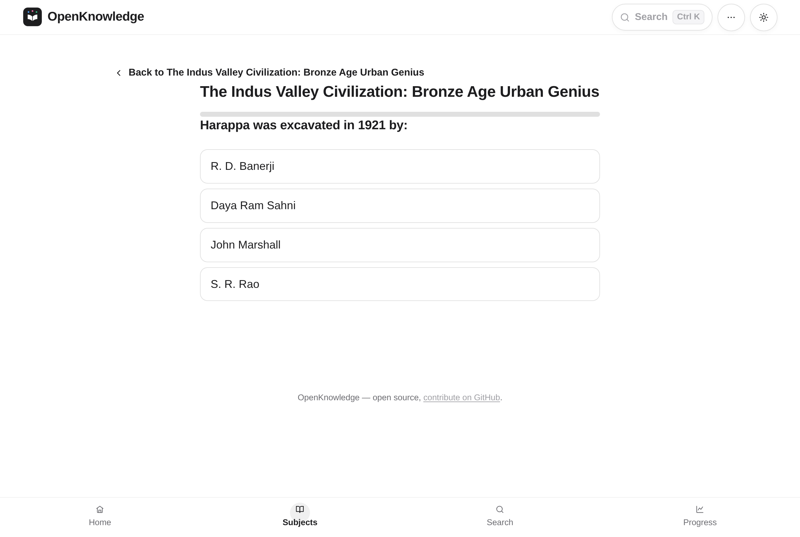
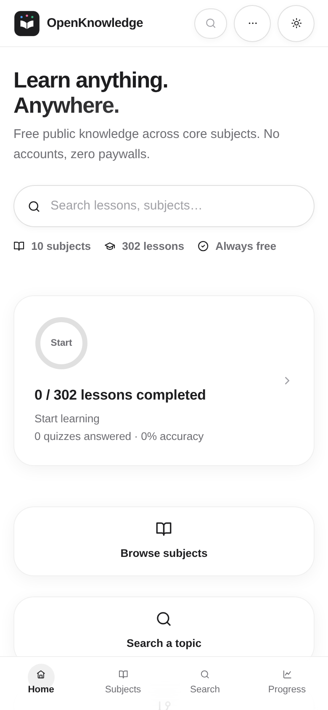

<div align="center">



# OpenKnowledge

### Knowledge is everyone's right.

**A free, open-source, text-first knowledge base — 302 lessons, 3,104+ quiz questions,
10 subjects. No accounts, no ads, no paywalls. Works offline.**


[Open the app](https://uxle.github.io/OpenUniversity/) · [Report a bug](../../issues) · [Add a lesson](CONTRIBUTING.md) · [Branding kit](BRANDING.md)

</div>

---

OpenKnowledge turns written knowledge into an interactive learning experience.
Every lesson is a clean, focused reading page — with tables, worked examples and
visual explanations — and ends with a multiple-choice quiz whose wrong answers
teach, not just scold. Progress, bookmarks and notes stay on your device. There
is nothing to sign up for, and nothing to pay.

No video courses required. No build step. No CDN. Clone it, open it, learn.

## ✨ Highlights

- **302 text-first lessons** across 10 subjects — written to be understood, not skimmed
- **3,104+ MCQs** with per-option rationales, instant feedback and a results summary
- **Works offline** — service worker caches the app and content; installable as a PWA
- **Command palette** (Ctrl/Cmd + K) — jump to any lesson, subject or action
- **Per-lesson translation**, PDF export, reading-time estimates, keyboard lesson navigation
- **Progress tracking, bookmarks, personal notes** — all stored locally, private by default
- **Light, dark and high-contrast themes**, automatic via `prefers-color-scheme`
- **Zero runtime dependencies** — no CDN, no icon fonts, no framework; pure web platform
- **Accessible by design** — skip links, focus rings, AA contrast, screen-reader labels
- **37/37 automated tests**, content validated on every commit (`npm run validate:all`)

## 🎨 Design — "Ink & Accent"

The interface is **black & white first**: near-black ink on paper white, so nothing
competes with what you're reading. Color is *optional decoration* — a soft pastel
on each subject's icon, a gentle highlight under search matches, functional
green/red on quizzes — never on large surfaces, never on body text.

| | Token | Value |
|---|---|---|
| ⬛ | Ink (text, buttons, identity) | `#1d1d1f` |
| ⬜ | Paper (background) | `#ffffff` |
| 🔵 | Brand hue (selection, small accents) | `#4d9df8` |
| 🟨 | Highlight (search & lesson marks) | `#fff3bf` |

Each subject owns one pastel — that's the only place hues live:

| Subject | | Subject | |
|---|---|---|---|
| Mathematics | `#4d9df8` | History | `#ec8a4c` |
| Computer Science | `#7a70f2` | Economics | `#d9a527` |
| Philosophy | `#a06ce8` | Science | `#35b37e` |
| Languages | `#ee6fa4` | Geography | `#2db5ae` |
| Civics | `#e75d6f` | Reasoning | `#38b6e0` |

Dark theme inverts the identity (white on black) and lifts every pastel; the
high-contrast theme strips decoration entirely for AAA-leaning readability.
Full rules, logo files and the media kit live in [BRANDING.md](BRANDING.md).

## 📱 Screenshots

<div align="center">

</div>

| | |
|---|---|
|  |  |
| **Quizzes that teach** — rationales for every option | **Mobile-first** — floating bottom nav, liquid type |

## 🚀 Quick start

**Read online:** [uxle.github.io/OpenUniversity](https://uxle.github.io/OpenUniversity/) — install it as an app from your browser menu (*Add to Home Screen / Install*) for offline use.

**Run locally** (any static server works, no install step):

```bash
git clone https://github.com/uxle/OpenUniversity.git
cd OpenUniversity
npx serve .          # or: python3 -m http.server 8000
```

> ⚠️ **Page shows "This page couldn't load"?** That's one broken/missing file failing
> only its own route — almost always an incomplete extraction. Delete the folder and
> re-extract fresh (don't merge over an old copy).

**Development:**

```bash
npm run validate:all   # regenerate registry + validate content + rebuild CSS
npm run build:css      # rebuild src/styles/main.bundle.css after style edits
npm test               # 37 tests across content, engines and services
```

## 📚 What's inside

| Subject | Lessons | | Subject | Lessons |
|---|---:|---|---|---:|
| Reasoning | 109 | | Computer Science | 20 |
| Languages | 51 | | Mathematics | 19 |
| Science | 34 | | Economics | 13 |
| Civics | 18 | | Geography | 13 |
| History | 14 | | Philosophy | 11 |
| | | | **Total** | **302** |

Lessons are written in **Zolto** — a tiny, testable content format (tables, math,
callouts, examples) stored as plain text under `src/subjects/`. Every lesson has a
matching MCQ set registered in the search index, so everything is findable from the
command palette in two keystrokes.

## 🤝 Contribute

Lessons, fixes, translations, subject ideas — all welcome, all sizes.
See [CONTRIBUTING.md](CONTRIBUTING.md) for the lesson format and the
validation workflow (write → `npm run validate:all` → PR).

If OpenKnowledge saved you a textbook or a tuition fee, consider starring the
repo — it genuinely helps other learners find it.

## 📣 Branding & media kit

Logos, the "Ink & Accent" palette, usage rules and ready-to-post advertising
posters live in [`assets/branding/`](assets/branding/) — see
[BRANDING.md](BRANDING.md). Share the posters freely; the owl doesn't mind.

## 📄 License

[MIT](LICENSE) — free to use, study, fork and share.
